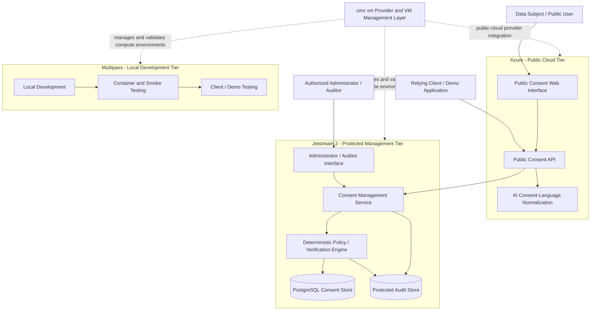

# Cloud-Native Biometric Consent and Audit Platform

**Student:** Stephanie Wallace  
**Loyola Email:** swallace6@luc.edu  
**GitHub ID:** AnieWall  
**Course:** Cloud Computing, DevOps, and AI  
**Instructor:** Professor Gregor von Laszewski  
**Date:** October 15, 2026  
**Status:** Project Architecture and Implementation Update

---

## Abstract

The Cloud-Native Biometric Consent and Audit Platform is a multi-tier cloud system for managing consent associated with simulated biometric-data use. The system separates public consent interactions from protected administrative and audit functions, allowing a data subject to create, review, verify, and revoke consent while restricting management and audit operations to authorized users. A relying client can query the platform before a simulated biometric operation and receive a deterministic allow-or-deny decision based on the current consent record, approved purpose, and revocation state.

The current architecture uses three cloud environments with distinct roles: Multipass for local development and repeatable testing, Jetstream 2 for the protected management and audit tier, and Azure as the public-cloud environment for the public-facing application tier. The design integrates the shared `cmx vm` framework as the common VM-management and provider-validation layer. Containerized services, Kubernetes deployment, automated testing, GitHub-based DevOps practices, and an AI-assisted consent-language normalization component extend the system beyond the earlier biometric-consent research into a cloud systems implementation.

The prototype uses synthetic identifiers and simulated biometric events. No real biometric information is required for the class implementation.

---

## 1. System Purpose

Applications that rely on biometric information may need to determine whether valid consent exists before a biometric operation is performed. The decision depends on more than the existence of a consent record. The system must also determine whether the consent:

- belongs to the relevant data subject;
- covers the requested purpose;
- is currently active;
- has been revoked; and
- can be demonstrated later through an audit record.

The platform provides these capabilities as a reusable cloud service rather than embedding all consent logic inside one client application.

A relying application can therefore ask a focused question such as:

> Does valid consent currently exist for this synthetic subject and this specific biometric purpose?

The consent service evaluates the stored record and returns a deterministic decision. Each verification, denial, update, and revocation event is recorded for later audit.

---

## 2. Relationship to the Earlier Biometric Project for a Previous Class

The earlier biometric work focused primarily on the consent model itself, including consent capture, purpose limitation, verification, revocation, auditability, and the legal or regulatory principles that influence biometric-consent design.

The Cloud Computing project however, addresses a different technical problem: how that consent model can be implemented and operated as a secure, multi-tier cloud service.

The current work adds:

- multi-cloud infrastructure;
- public and protected service tiers;
- VM lifecycle management through `cmx vm`;
- containerized deployment;
- Kubernetes-based public service hosting;
- REST APIs;
- persistent cloud data services;
- role-based administrative separation;
- automated and repeatable provider testing;
- DevOps workflows using GitHub branches, pull requests, and tests;
- cloud security boundaries;
- AI-assisted consent-language normalization; and
- client applications that consume the consent service.

The project therefore uses the earlier consent research as domain background while concentrating on cloud architecture, deployment, security, automation, and system integration.

---

## 3. User Groups and Trust Boundaries

The architecture separates two primary user groups because they require different privileges and interfaces.

### 3.1 Data Subject / Public User

The public user can:

- register using synthetic identity data;
- review the purpose for which consent is requested;
- grant or refuse consent;
- check current consent status; and
- revoke previously granted consent.

The public interface does not expose administrative or audit-management capabilities.

### 3.2 Administrator / Auditor

Authorized administrative users can:

- manage predefined consent purposes and policy metadata;
- review consent state;
- inspect revocation events;
- review audit records;
- investigate failed or denied verification requests; and
- manage operational settings required by the protected service tier.

Administrative functions are isolated from the public interface and require stronger authentication and authorization controls.

---

## 4. Functional Workflow

The core consent lifecycle is:

```text
Registration
    |
    v
Consent Creation
    |
    v
Purpose-Bound Consent Record
    |
    v
Consent Verification Request
    |
    +---- valid and active ----> ALLOW
    |
    +---- absent / revoked /
          wrong purpose -------> DENY
    |
    v
Audit Event

Consent may later be revoked, after which subsequent verification requests must return DENY.
```

A separate relying client application demonstrates how another system consumes the consent-verification API before performing a simulated biometric operation.

---

## 5. Multi-Cloud Architecture

The current design assigns a distinct role to each of the three required cloud environments.

| Environment | Category | Primary Role | Current State |
| --- | --- | --- | --- |
| **Multipass** | Local | Development, container testing, smoke testing, client/demo execution | Validated through existing CLI and lifecycle smoke tests |
| **Jetstream 2** | OpenStack | Protected consent-management, audit, and backend service tier | Real-cloud VM workflows previously validated |
| **Azure** | Public cloud | Public-facing application tier and Kubernetes-hosted consent interface | Selected public-cloud target; live `cmx vm` validation remains to be completed |

### 5.1 Logical Architecture



The public and protected tiers form a security boundary. Public requests enter through the Azure-hosted service layer. Consent-management, administrative, persistent-data, and audit operations remain in the protected backend tier.

---

## 6. `cmx vm` Integration

The shared `cloudmesh-ai-vm` framework provides the infrastructure-management layer used to work with the selected environments.

The project uses `cmx vm` for activities such as:

- selecting a provider;
- inspecting provider information;
- listing available VM resources;
- starting and stopping test virtual machines;
- validating provider lifecycle behavior;
- checking images and flavors;
- testing key-management operations;
- verifying resource cleanup; and
- recording repeatable smoke-test evidence.

The project services run on top of these compute environments. `cmx vm` is therefore not the consent application itself; it is the common infrastructure-control and validation layer supporting the multi-cloud deployment.

### 6.1 Current `cmx vm` Validation

Multipass has been validated on Windows using the existing CLI and unified lifecycle smoke tests. The lifecycle test covered VM creation, running-state detection, connectivity, temporary SSH-key upload and deletion, shelve and unshelve behavior, VM information, stop, deletion, and cleanup.

Jetstream has also been exercised using real OpenStack resources during the shared-provider work.

Azure remains the outstanding public-cloud provider that must be configured and validated against the current `dev2` implementation.

---

## 7. Application Components

### 7.1 Public Consent Interface

The public-facing service provides registration and consent-management operations for data subjects. It exposes only the functionality required for public interaction.

### 7.2 Consent Verification API

The verification API accepts a synthetic subject identifier, requested purpose, and client context. It returns a structured decision such as:

```json
{
  "decision": "allow",
  "purpose": "account-authentication",
  "consent_status": "active"
}
```

The final allow-or-deny result is deterministic and is based on structured consent state rather than a free-form AI response.

### 7.3 Consent Management Service

The protected management service maintains consent lifecycle operations, including creation, status changes, revocation, and policy metadata.

### 7.4 Administrator / Auditor Interface

This interface is available only to authorized users and supports operational review, audit inspection, and controlled administrative functions.

### 7.5 Client / Demo Application

A separate client demonstrates how another application depends on the consent platform.

Before a simulated biometric action, the client sends a verification request. The client continues only when the service returns an active consent decision for the required purpose.

This design demonstrates that the consent platform is a reusable service rather than a single standalone website.

---

## 8. Data Architecture

PostgreSQL is the primary structured-data store for the cloud implementation.

The database can contain:

- synthetic subject identifiers;
- consent identifiers;
- allowed purposes;
- consent state;
- timestamps;
- revocation metadata;
- client identifiers;
- policy references; and
- audit-event references.

Real facial images are not required for the class prototype.

If a simulated biometric reference is needed for integration testing, it is separated from the consent record and linked through a synthetic or pseudonymous identifier. The consent database is not treated as a general repository for biometric images.

---

## 9. AI Integration

AI is used as an assistive interpretation layer rather than as the final authorization mechanism.

A user may provide human-readable consent language such as:

```text
Facial verification may be used for account login,
but not for advertising.
```

The AI component converts or suggests structured attributes such as:

```text
authentication: allowed
advertising: denied
```

The structured result is validated before storage. The final verification decision remains rule-based and depends on approved purpose, current consent state, and revocation status.

This separation prevents an LLM from independently authorizing biometric-data use.

Potential AI functions include:

- consent-language normalization;
- extraction of purpose restrictions;
- detection of ambiguous consent text;
- comparison between requested purpose and recorded consent scope; and
- generation of human-readable explanations for administrative review.

---

## 10. DevOps Architecture

The implementation follows the GitHub-based DevOps workflow used throughout the course.

### 10.1 Version Control and Collaboration

Development uses:

- Git branches for isolated work;
- small focused commits;
- pull requests;
- regression tests;
- review before integration; and
- documented validation evidence.

Work on the shared `cloudmesh-ai-vm` repository has already exercised this workflow through multiple pull requests and provider tests.

### 10.2 Containerization

Application services are organized for Docker-based execution. Docker and Docker Compose support local integration testing, while the public cloud tier is designed for Kubernetes deployment.

Containerization keeps the application environment portable across local and cloud infrastructure.

### 10.3 Automated Testing

Testing includes:

- unit tests for consent rules;
- API tests;
- provider smoke tests;
- lifecycle tests;
- negative authorization tests;
- revocation tests;
- resource-cleanup verification; and
- credential-leakage checks.

### 10.4 CI/CD Direction

GitHub Actions will be used for automated test execution and container validation as implementation progresses. Cloud deployment remains separated from source-control credentials through environment-specific secret management.

---

## 11. Security and Privacy Architecture

Security is a primary system requirement because consent records relate to sensitive biometric-data use.

### 11.1 Identity and Access Management

The system separates public users from administrative users and applies role-based access controls.

Administrative and audit functions require explicit authorization and are not exposed through the same public interface used for consent creation or verification.

### 11.2 Least Privilege

Each service receives only the permissions required for its function. Public services do not receive direct administrative privileges over protected data services.

### 11.3 Encryption

The architecture requires:

- TLS for service-to-service and client-to-service traffic;
- encryption at rest for persistent consent and audit data; and
- secure handling of encryption keys and application secrets.

### 11.4 Secrets Management

Passwords, API tokens, cloud credentials, private SSH keys, and other secrets must not be committed to GitHub.

Environment-specific secrets are injected at runtime through protected configuration or cloud secret-management mechanisms.

### 11.5 Audit Logging

Important events are recorded, including:

- consent creation;
- consent verification;
- allow and deny decisions;
- consent updates;
- revocation;
- administrative access; and
- policy changes.

Audit records are separated from ordinary application logs so that security-relevant events can be reviewed independently.

### 11.6 Data Minimization and Purpose Limitation

Only information necessary for the demonstration is stored. Consent is explicitly associated with a defined purpose, and a request for a different purpose must not inherit authorization automatically.

### 11.7 Threat Considerations

The design considers threats including:

- unauthorized administrative access;
- credential leakage;
- privilege escalation;
- unauthorized consent modification;
- replay or misuse of stale consent;
- processing after revocation;
- cross-cloud communication exposure;
- log tampering; and
- unintended storage of sensitive biometric information.

---

## 12. Cloud Computing, DevOps, and AI

The project addresses the three course areas directly.

| Course Area | Project Implementation |
| --- | --- |
| **Cloud Computing** | Multi-cloud deployment across Multipass, Jetstream 2, and Azure; VM lifecycle management; public/protected service separation; persistent cloud storage; Kubernetes-hosted public tier |
| **DevOps** | GitHub workflow, pull requests, Docker, repeatable tests, provider smoke tests, CI/CD, documentation, resource cleanup, and `cmx vm` integration |
| **AI** | Consent-language normalization, purpose extraction, ambiguity detection, and assistive explanation while deterministic rules retain final authorization control |

---

## 13. Current Implementation and Validation Status

### Completed or Demonstrated

- Project scope has been separated from the earlier biometric research.
- Public-user and administrator/auditor roles have been defined.
- Consent creation, verification, revocation, and audit requirements have been identified.
- Multipass has been validated with repeatable CLI and lifecycle smoke tests.
- Jetstream VM workflows have been exercised with real cloud resources.
- Shared `cmx vm` defects have been reproduced, tested, and submitted through focused pull requests.
- SSH key-management behavior has been tested on Windows.
- Security requirements and trust boundaries have been incorporated into the architecture.

### In Progress

- Azure account/provider configuration and live `cmx vm` validation.
- Public Kubernetes deployment on Azure.
- Protected Jetstream management-tier deployment.
- PostgreSQL schema implementation.
- Public consent API implementation.
- Administrator/auditor interface.
- Docker packaging of project services.
- AI-assisted consent-language normalization.
- Cross-cloud secure communication.
- Automated project CI/CD workflow.

---

## 14. Issues and Open Questions

The following items require further implementation or validation:

- Azure must be configured and tested as the required public-cloud provider.
- The Azure Kubernetes deployment must be implemented within available course resource and cost limits.
- The protected Jetstream management tier requires a finalized network-access design.
- Secure communication between the public Azure tier and protected Jetstream tier must be established.
- The PostgreSQL deployment location and backup strategy must be finalized.
- Audit-log tamper resistance requires a concrete implementation.
- Administrative authentication and role mapping require final configuration.
- The AI normalization component requires an evaluation method for incorrect or ambiguous extraction.
- Synthetic data must remain clearly separated from any real biometric information.
- Final Docker/Docker Compose and Kubernetes deployment workflows require end-to-end validation.

---

## 15. Evaluation Criteria

The implementation will be evaluated through observable system behavior.

| Capability | Success Condition |
| --- | --- |
| Consent creation | A synthetic consent record is stored with a defined purpose and active state |
| Verification | A valid, active, purpose-matching consent returns `allow` |
| Purpose limitation | A request for an unapproved purpose returns `deny` |
| Revocation | A revoked consent returns `deny` on subsequent verification |
| Auditability | Consent lifecycle and verification events appear in the protected audit record |
| Role separation | Public users cannot access administrator/auditor operations |
| Multi-cloud operation | Required project components can be demonstrated across the selected local, OpenStack, and public-cloud environments |
| `cmx vm` integration | Provider and VM-management workflows are demonstrated for the selected cloud environments |
| Containerization | Application services execute through Docker-based deployment |
| AI integration | Human-readable consent text can be converted into structured attributes for validation without allowing the LLM to make the final authorization decision |
| Security hygiene | No cloud credentials, private keys, passwords, or tokens are stored in the public repository |

---

## 16. Project Deliverables

The project deliverables include:

- `project.md` with architecture, implementation status, issues, and evaluation criteria;
- architecture diagram;
- source code for consent services and client/demo application;
- Docker configuration;
- Kubernetes deployment configuration for the public-cloud tier;
- PostgreSQL schema;
- automated tests;
- `README.md` with setup and execution instructions;
- `TUTORIAL.md` with an end-to-end user walkthrough;
- security and privacy documentation;
- cloud/provider validation evidence; and
- final technical summary and presentation.

---

## 17. Relevant Course Resources

- Project Ideas and Requirements:  
  https://cloudmesh-ai.github.io/cloudmesh-ai-lecture/lecture/assignments/ideas/

- Technical Report Writing:  
  https://cloudmesh-ai.github.io/cloudmesh-ai-lecture/section/writing/report/

- Cloud Computing Introduction:  
  https://cloudmesh-ai.github.io/cloudmesh-ai-lecture/lecture/cloud/introduction/

- Virtualization:  
  https://cloudmesh-ai.github.io/cloudmesh-ai-lecture/lecture/cloud/virtualization/

---

## 18. Current Project Status

The project has moved beyond the initial proposal stage into architecture refinement and implementation planning tied to tested cloud infrastructure.

The current design separates public consent access from protected administrative and audit functions, assigns clear roles to Multipass, Jetstream 2, and Azure, and integrates `cmx vm` as the common infrastructure-management layer.

The immediate technical priorities are Azure provider validation, public-cloud Kubernetes deployment, protected Jetstream service deployment, containerized service implementation, PostgreSQL integration, and completion of the end-to-end consent verification and revocation flow.
